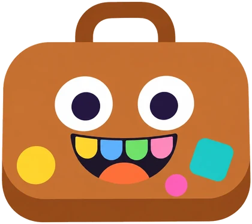

# Vokaboka

Ein Vokabel-Spiel für Französisch (Lehrmittel «dis donc!», Unité 1–4) mit deutschen Übersetzungen.
Jedes richtig beantwortete Wort wandert als Gegenstand in den Wortkoffer **Boka**. Mit den gesammelten Wörtern
schaltet man Frisuren, Kleider und Accessoires für eigene Figuren frei. Die Figuren leben in einem begehbaren Haus,
in dem Möbel und Dinge ihr französisches Wort sprechen.



## Was drin ist

- **Quiz** mit 347 Einträgen: antippen oder selber schreiben, Französisch → Deutsch, Deutsch → Französisch oder gemischt.
  Falsche Antworten kommen später nochmal.
- **Wortliste** mit Suche und Filter nach Unité, Zahlen und Klassensprache.
- **Koffer** mit allen gesammelten Wörtern und einem Sterne-System.
- **Avatar-Studio** (Pastel-Streetwear-Look): Haut, Haare, Augen, Gesicht, Oberteile, Hosen, Schuhe, Extras, Zufalls-Look,
  Rückgängig/Wiederholen, bis zu 40 gespeicherte Figuren und 24 fertige Looks.
- **Das Haus** mit drei Stockwerken, Garten und Treppe. Alle Möbel und Dinge sprechen ihr Wort und lassen sich verschieben. Die Figur läuft zum angetippten Ort und zählt auf der Treppe von
  «un» bis «cinq».
- **Stimme**: 453 vorgesprochene Clips (ElevenLabs, langsam gesprochen) in `voice-fr.json`.
  Vorgelesen wird nur, was man antippt. Wer will, stellt auf der Startseite «Automatisch» ein.

## Starten

Die App ist eine einzelne HTML-Datei. Wegen der Stimmen-Datei braucht sie einen kleinen Webserver:

```bash
python -m http.server 8765
```

Dann `http://localhost:8765/` öffnen. Der Spielstand liegt im Browser (`localStorage`, Schlüssel `vokaboka.v1`).

## Aufbau

| Pfad | Inhalt |
|---|---|
| `index.html` | die ganze App (HTML, CSS, JavaScript), GSAP kommt von cdnjs |
| `voice-fr.json` | Sprachclips als `data:audio/mpeg`, Schlüssel ist der gesprochene Text |
| `assets/boka.webp` | das Boka-Logo |
| `design-system/` | React-Bibliothek `@vokaboka/ui` mit allen Bausteinen (Buttons, Karten, Figur, Studio, Räume) und der Konfiguration für den Abgleich mit Claude Design |

## Design

Pastel Streetwear Studio: Off-White `#F8F7F4`, Dark Ink `#262238`, Electric Lilac `#8A5CF6`, Lime `#C8F36B`, Pop Pink `#FF78A6`.
Schriften: Space Grotesk für Überschriften, Inter für die Oberfläche, Andika für die Vokabeln.

## Hinweis

Die Vokabeln stammen aus dem Lehrmittel «dis donc!». Die Antworten «die Wandtafel» und «die Tafel» gelten beide als richtig.
